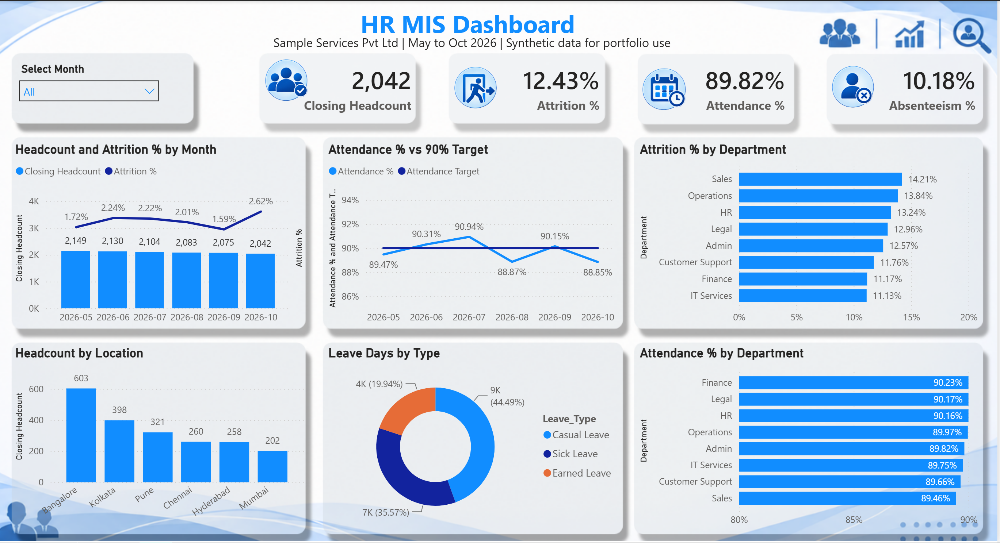

# HR MIS Reporting Pack

An end-to-end monthly HR MIS reporting workflow built with **Excel, VBA and Power BI**. Six monthly employee extracts are consolidated, validated, corrected and turned into five reports, an Excel dashboard and a Power BI dashboard.

> **All data is synthetic.** "Sample Services Pvt Ltd" is a fictional company. No real employee data is used.



## Why I built this

HR MIS roles are about producing accurate recurring reports from messy employee data on a deadline. This project mirrors that work: take raw monthly files, find and fix data problems, calculate agreed KPIs, and deliver a dashboard that refreshes with one click.

## What it does

| Step | What happens | Tool |
| --- | --- | --- |
| 1. Consolidate | Merges the 6 monthly files (12,892 rows) into one `Master_Data` sheet | VBA |
| 2. Clean | Converts text dates to real dates, standardises department names, adds helper columns | VBA |
| 3. Validate | Checks 5 data quality rules and logs every issue | VBA |
| 4. Fix | Removes duplicates, fills blanks from the employee master, corrects dates, flags attendance errors | VBA |
| 5. Report | Builds 5 report sheets (12 pivot tables) with conditional formatting | VBA + PivotTables |
| 6. Summarise | Summary sheet with month selector, KPI cards and refresh buttons | VBA |
| 7. Dashboard | Excel dashboard (4 KPI cards, 6 charts) and a Power BI dashboard | VBA, Power BI |

## Data quality results

Each monthly file contains deliberately planted errors, listed in `raw_data/answer_key_injected_errors.csv`, so the validation macro can be checked against an answer key. All 156 were found.

| Rule | Found | Action |
| --- | --- | --- |
| DQ1 Duplicate employee in a month | 48 | Row removed |
| DQ2 Blank department | 36 | Filled from employee master |
| DQ3 Blank location | 30 | Filled from employee master |
| DQ4 Days present greater than working days | 24 | Flagged `DQ_Exclude` and left out of attendance metrics (one of the 24 rows was also a duplicate and was removed) |
| DQ5 Exit date before join date | 18 | Exit date corrected from employee master |

`Master_Data` goes from 12,892 rows to 12,844 after cleaning. Every fix is recorded in a `Fix_Log` sheet.

## Reports and KPIs

| Report | Content |
| --- | --- |
| R1 Headcount | Closing headcount by department and by location |
| R2 Joiners and exits | Opening, joiners, exits, closing by month |
| R3 Attrition | Attrition % by department, location and salary band |
| R4 Attendance | Attendance %, absenteeism % and unauthorised absence % |
| R5 Leave | Leave days by type, month and department |

**Definitions**
- Closing headcount = opening + new joiners - exits
- Attrition % = exits / average of opening and closing headcount
- Attendance % = days present / working days
- Absenteeism % = (leave days + unauthorised absence) / working days. This includes approved leave.

**Sample results (May to Oct 2026, synthetic)**
- Closing headcount moved from 2,149 (May) to 2,042 (Oct).
- Monthly attrition ranged from 1.6% (Sep) to 2.6% (Oct).
- Monthly attendance ranged from 88.9% to 90.9%, around the 90% target.

## Tools

Excel (PivotTables, conditional formatting, formulas), VBA (7 modules), Power BI (DAX measures), Python (pandas) was used to generate the synthetic dataset.

## Repository structure

```
hr-mis-reporting-pack/
├── raw_data/               synthetic employee master, 6 monthly extracts, error answer key
├── excel/                  HR_MIS_Report_Final.xlsm
├── powerBI/                PowerBI_Dashboard.pbix
├── vba/                    exported VBA modules (.bas)
├── docs/                   Report Requirement
├── screenshots/            Power BI and Excel dashboard images
└── README.md
```

## How to use it

### Monthly update (adding a new month)

1. **Prepare the new month's file.** Save it as `HR_MIS_YYYY_MM.xlsx` (for example `HR_MIS_2026_11.xlsx`). It must have the same columns as the earlier monthly files.
2. **Update the employee master.** Add new joiners and exit dates to `employee_master.csv`. The macros use it to fill blank departments and locations and to correct exit dates.
3. **Put both in one data folder.** Keep all monthly files and `employee_master.csv` together, with the new month's file added.
4. **Open `HR_MIS_Report_Final.xlsm`** and click **Enable Content** so macros can run.
5. **Run the full monthly update.** On the `Summary` sheet, click **Run full monthly update**. When asked, select the data folder and then `employee_master.csv`. The macro then:
   - merges all monthly files into `Master_Data`
   - cleans dates and department names
   - validates the 5 data quality rules and logs each issue
   - fixes the errors and writes every change to `Fix_Log`
   - rebuilds the 5 report sheets, the Summary and the Excel dashboard
6. **Check the results.** Open `DQ_Summary` to see how many issues were found and fixed, and compare the row count with the data you loaded.
7. **Choose the month.** Use the **Select month** cell on `Summary` or `Dashboard` to view any month.
8. **Save the workbook.** Power BI reads the saved file, so save before the next step.
9. **Refresh Power BI.** Open `PowerBI_Dashboard.pbix` and click **Refresh**. The new month appears in the slicer and in every chart.

### Using the reports

| Sheet | What to use it for |
| --- | --- |
| `Summary` | Month selector, headline KPIs, update and refresh buttons |
| `Dashboard` | Excel dashboard: 4 KPI cards and 6 charts |
| `R1_Headcount` to `R5_Leave` | The five detailed pivot reports |
| `DQ_Summary` and `Fix_Log` | Audit trail of every data issue and fix |
| `Master_Data` | Cleaned dataset behind all reports |

### If Power BI cannot find the data

In Power BI Desktop go to **Transform data → Data source settings**, select the Excel source, click **Change Source** and choose the saved `.xlsm` file again.

## What I learned

- Validating data before reporting. The corrected figures only mean something if the checks are logged.
- Reading CSV files safely in VBA, where line endings and date formats can silently break a macro.
- Writing KPI definitions down first, and checking each report against an independent calculation.

## Author

Prasad, Kolkata. Self-taught data analyst (SQL, Python, Excel, Power BI).
